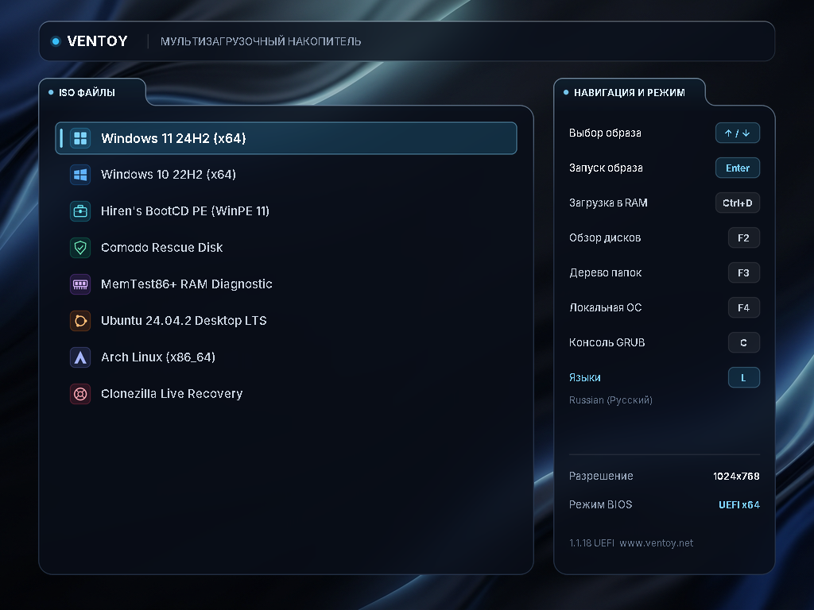

# Ventoy Theme — Glass Luxe (`1024x768`)

Minimalist dark frosted-glass bootloader theme for **Ventoy** (`1.1.x+`), engineered pixel-for-pixel at universal **`1024×768` (4:3)** resolution for 100% compatibility across both **UEFI GOP** and **Legacy BIOS (VBE)**. Available in **Russian (`RU`)** and **English (`EN`)** interface editions.

Минималистичная тёмная тема в стиле матового стекла (*Dark Frosted Glass*) для мультизагрузочной флешки **Ventoy** (`1.1.x+`) в универсальном разрешении **`1024×768` (4:3)** — одинаково чётко работает как в **UEFI**, так и в **Legacy BIOS**. Доступна в двух версиях интерфейса: **Русской (`RU`)** и **Английской (`EN`)**.



---

## RU — Особенности и установка

### Особенности
- **Универсальное разрешение `1024×768`:** мгновенная отрисовка без растяжения и лагов как на современных UEFI-платах, так и на старых ПК в режиме Legacy BIOS.
- **Дизайн Glass Luxe с инвертированными вкладками:** матовые стеклянные панели с плавными вогнутыми сопряжениями вкладок (`ISO ФАЙЛЫ` и `НАВИГАЦИЯ И РЕЖИМ`) и тонкой контурной подсветкой `1px`.
- **Честное автоопределение режима загрузки и разрешения:** автоматический вывод `UEFI x64` / `UEFI IA32` / `UEFI ARM64` / `Legacy BIOS` и текущего видеорежима `@@gfxmode` в правой панели, а также динамических индикаторов `[Memdisk]`, `WIMBOOT Mode`, `GRUB2 Mode`, `Compatible Mode` в верхней шапке.
- **Шрифты `Inter` (`.pf2`):** кастомный набор кириллических и латинских шрифтов GRUB2 с выверенной базовой линией и отсутствием наездов плашки выбора.
- **Полный набор индивидуальных иконок (`28×28`):** отдельные силуэты для Windows 11, Windows 10, WinPE / Hiren's BootCD, Антивирусов (Comodo / Kaspersky / Dr.Web), MemTest86, дистрибутивов Linux, утилит восстановления, дисков `F2`, папок `F3` и всех пунктов вторичного меню запуска ISO (`normal`, `wimboot`, `grub2`, `memdisk`, `checksum`).

### Установка на флешку
1. Перейдите в раздел **[Releases](../../releases)** и скачайте нужную версию языка:
   - **`Glass_Luxe_1024x768_RU.zip`** — русский интерфейс
   - **`Glass_Luxe_1024x768_EN.zip`** — английский интерфейс
2. Распакуйте папку **`ventoy`** из архива прямо в **корень первого раздела флешки Ventoy** (туда, где лежат ваши `.iso` файлы):
   ```text
   <Флешка Ventoy>/
   └── ventoy/
       ├── ventoy.json
       ├── ventoy_grub.cfg
       └── theme/
           └── luxe/
               ├── theme.txt
               ├── background.png
               ├── *.pf2
               └── icons/
   ```
   *(Либо скопируйте папку `ventoy` напрямую из каталога [`ru/`](./ru/) или [`en/`](./en/) этого репозитория).*

> **Если у вас уже есть свой `ventoy.json`** (со своими `menu_alias` и `menu_class`): достаточно скопировать только папку `ventoy/theme/luxe` (и при необходимости `ventoy/ventoy_grub.cfg`), а в вашем `ventoy.json` прописать секции `"theme"` и `"control_*"` по образцу из репозитория.

### Горячие клавиши в меню
| Клавиша | Действие |
| :--- | :--- |
| `↑` / `↓` | Выбор ISO-образа или пункта меню |
| `Enter` | Запуск выбранного образа |
| `Ctrl + D` | Режим загрузки образа целиком в оперативную память (`[Memdisk]`) |
| `F2` | Обзор локальных дисков и разделов ПК |
| `F3` | Переключение вида: Список ↔ Дерево папок |
| `F4` | Загрузка локальной ОС (поиск Windows / загрузчиков на дисках ПК) |
| `C` | Открыть командную консоль GRUB2 |
| `L` | Выбор языка встроенных подменю Ventoy |

---

## EN — Features & Installation

### Features
- **Universal `1024×768` Layout:** crisp pixel-aligned rendering across both modern UEFI GOP displays and Legacy BIOS VBE hardware without sluggish redraws.
- **Frosted Glass UI with Inverted-Corner Tabs:** seamless concave-fillet tabs (`ISO FILES` & `NAVIGATION & MODE`) fused into dark glass cards with a continuous `1px` specular border.
- **Real-Time Boot Mode & Resolution Detection:** automatically detects `UEFI x64`, `UEFI IA32`, `UEFI ARM64`, or `Legacy BIOS` at boot via native `control_*` blocks alongside live `@@gfxmode` and mode badges (`[Memdisk]`, `WIMBOOT Mode`, `GRUB2 Mode`, `Compatible Mode`).
- **Custom `Inter` `.pf2` Typography & 19 Distinct Squircle Icons:** dedicated icons for Windows 11, Windows 10, WinPE/Hiren's, Antivirus Rescue Disks, MemTest86 RAM sticks, Linux distributions, `F2` drives, `F3` folders, and all ISO secondary boot menu items.

### Installation
1. Download your preferred language package from **[Releases](../../releases)**:
   - **`Glass_Luxe_1024x768_EN.zip`** — English UI edition
   - **`Glass_Luxe_1024x768_RU.zip`** — Russian UI edition
2. Extract the **`ventoy`** directory into the **root of your Ventoy USB drive's main ISO partition** (or copy `ventoy` directly from [`en/`](./en/) or [`ru/`](./ru/)).

---

## Repository Structure / Структура репозитория

```text
├── preview/
│   └── main_menu.png       # Main menu screenshot (1024x768)
├── ru/
│   └── ventoy/             # Russian UI edition (ready to copy to USB root)
├── en/
│   └── ventoy/             # English UI edition (ready to copy to USB root)
└── README.md
```
